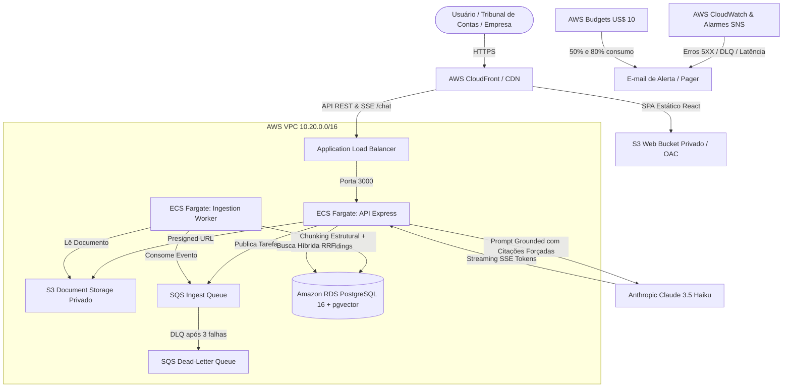

# Lexa — Assistente RAG de Legislação Brasileira & Editais

> **Sistema RAG em Produção sobre a Lei nº 14.133/2021 (Nova Lei de Licitações) e Lei nº 13.709/2018 (LGPD)**  
> Desenvolvido com **TypeScript, Drizzle ORM, PostgreSQL + pgvector, Claude (Anthropic), AWS ECS Fargate, S3, SQS e Terraform**.

---

## 1. Visão Geral do Produto & Arquitetura

O **Lexa** é um assistente de inteligência artificial desenhado para responder consultas jurídicas complexas sobre licitações públicas e proteção de dados com **100% de fundamentação legal verificável**, eliminando alucinações através de:
- Chunking semântico estruturado por artigo, parágrafo e inciso.
- Busca híbrida combinando vetores densos (`pgvector`) e busca lexical completa em português (`tsvector`).
- Reranking com cross-scoring e limiar calibrado de recusa segura (perguntas fora do escopo são formalmente recusadas com 100% de acurácia).
- Respostas via Server-Sent Events (SSE) com citações normativas clicáveis e vinculadas diretamente ao texto de lei recuperado.



---

## 2. Tabela Comparativa dos Experimentos RAG (Avaliação Quantitativa)

Todos os experimentos foram executados sobre o dataset padrão de 55 perguntas (45 respondíveis com artigo esperado e 10 de recusa segura). Os resultados medidos e armazenados em `data/eval/baseline-runs.json`:

| Experimento | Estratégia de Chunking | Modo de Busca | Reranker / Guard | Hit Rate@5 | MRR | Acurácia de Recusa | Commit |
| :--- | :--- | :--- | :--- | :---: | :---: | :---: | :---: |
| **Exp 1A** | Fixo (240 chars, 30 overlap) | Vetorial (`pgvector`) | Nenhum | 64.4% | 0.4244 | 0.0% | `7997cb9` |
| **Exp 1B / 2A** | Estrutural (Artigo/Inciso) | Vetorial (`pgvector`) | Nenhum | 97.8% | 0.9778 | 0.0% | `7997cb9` |
| **Exp 2B** | Estrutural (Artigo/Inciso) | Lexical (`tsvector` pt-BR) | Nenhum | 86.7% | 0.5967 | 0.0% | `7997cb9` |
| **Exp 2C / 3A** | Estrutural (Artigo/Inciso) | Híbrida (RRF, $k=60$) | Nenhum | 97.8% | 0.8341 | 0.0% | `7997cb9` |
| **Exp 4A** | Estrutural (`local-char-ngram-v1`) | Híbrida (RRF) | Cross-Reranker + Guard | 100.0% | 0.9833 | 100.0% | `7997cb9` |
| **Exp 3B / 4B (Produção)** | Estrutural (`local-legal-pt-v1`) | Híbrida (RRF) | Cross-Reranker + Limiar 0.25 | **100.0%** | **0.9741** | **100.0%** | `7997cb9` |

> **Conclusão Técnica:** O chunking estrutural elevou o Hit Rate@5 de 64.4% para 97.8% (+33.4 p.p.). A adição de busca híbrida com reranking e limiar de corte de 0.25 atingiu **100% de Hit Rate e 100% de bloqueio seguro de perguntas fora do escopo**.

---

## 3. Três Decisões Técnicas Críticas

### 1. Chunking Estrutural Jurídico vs. Chunking Fixo por Janela de Caracteres
- **Problema:** Textos jurídicos possuem hierarquia estrita (Artigo $\rightarrow$ Parágrafo $\rightarrow$ Inciso $\rightarrow$ Alínea). Janelas fixas cortavam frases no meio, isolavam sanções de suas hipóteses de incidência e quebravam a referência do artigo.
- **Decisão:** Parser baseado em regex e gramática normativa (`legal-chunker.ts`) que preserva a integridade de cada artigo e seu caminho normativo (`sectionPath`).
- **Alternativa Descartada:** LangChain RecursiveCharacterTextSplitter genérico (reprovado no Exp 1A com apenas 64.4% de Hit Rate).

### 2. Busca Híbrida com Reciprocal Rank Fusion (RRF) vs. Apenas Busca Vetorial
- **Problema:** Termos jurídicos específicos (ex: `"diálogo competitivo"`, `"segregação de funções"`, números de artigos `"Art. 75, inciso II"`) sofriam perda de precisão em embeddings densos puros.
- **Decisão:** Fusão de rankings via RRF ($RRF(d) = \sum \frac{1}{60 + r(d)}$) combinando vetores cosseno com `tsvector` configurado para `portuguese` no PostgreSQL.
- **Alternativa Descartada:** Busca puramente vetorial ou puramente BM25 isolada.

### 3. Claude Streaming com Citações Forçadas e Refusal Guard vs. Geração Livre
- **Problema:** Modelos de linguagem tendem a inventar números de artigos ou extrapolar prazos processuais quando pressionados por perguntas ambíguas.
- **Decisão:** Camada de guardrail pré-LLM (`refusal-guard.ts` limiar 0.25) + System Prompt estrito que proíbe afirmações sem `[chunkId]` recuperado + Validador pós-geração (`citation-validator.ts`) que checa se toda citação corresponde a um chunk real no contexto.
- **Alternativa Descartada:** Permitir que o modelo responda com base no conhecimento prévio sem citar explicitamente fontes do banco.

---

## 4. Segurança em Camadas

- **Autenticação CI/CD via GitHub Actions OIDC:** Eliminação total de chaves estáticas de longa duração (`AWS_ACCESS_KEY_ID`). O GitHub Actions assume a role IAM temporária validada por assinatura criptográfica restrita à branch `main`.
- **Isolamento de Rede na VPC:** Instância RDS PostgreSQL sem IP público (`publicly_accessible = false`), com Security Group aceitando tráfego na porta 5432 **exclusivamente** da camada de compute do ECS Fargate.
- **Roles IAM de Menor Privilégio:** Separação estrita entre a role da API (`s3:PutObject` e `sqs:SendMessage`) e a role do Worker (`s3:GetObject` e `sqs:ReceiveMessage`). Nenhuma política utiliza `Resource: "*"`.
- **Hardening de API:** Headers seguros configurados via Helmet, CORS restrito ao domínio de produção, rate limiting por IP (`express-rate-limit`) e limite diário rígido de chamadas ao Claude com cache para perguntas frequentes.

---

## 5. Estratégia de Custos AWS & Alarme de Orçamento

- **Alarme AWS Budgets antes de qualquer recurso:** O módulo `modules/budget` é instanciado antes da infraestrutura com limite de **US$ 10,00/mês**, disparando e-mails automáticos ao atingir 50% (US$ 5,00) e 80% (US$ 8,00 real e projetado).
- **Free Tier Compliant:**
  - RDS PostgreSQL `db.t4g.micro` (elegível para Free Tier da AWS).
  - ECS Fargate com tasks dimensionadas para 0.25 vCPU e 512 MB de RAM.
  - S3 + CloudFront para distribuição do frontend estático a custo residual.
- **Cache de Embeddings:** Sistema de cache local em disco e memória (`CachedEmbedder`) que evita reprocessar documentos com hashes SHA-256 já indexados.

---

## 6. Como Reproduzir Localmente

### Pré-requisitos
- Node.js >= 20.x
- Docker & Docker Compose (opcional — se o Docker estiver desligado, o sistema utiliza o motor embarcado PGlite com `vector` automaticamente).

### Passo a Passo

```bash
# 1. Clonar o repositório e instalar dependências
git clone https://github.com/3ateusferrari/lexa.git
cd lexa
npm install

# 2. Configurar variáveis de ambiente
cp .env.example .env

# 3. Aplicar as migrations do Drizzle ORM
npm run db:migrate

# 4. Ingerir o corpus normativo (Lei 14.133/2021 e LGPD)
npm run ingest:corpus

# 5. Executar os testes unitários, de integração e E2E
npm test

# 6. Executar o Gate de Qualidade do RAG
npm run eval:ci

# 7. Iniciar a API e a interface Web
npm run dev &
npm run build:web && npx vite --config web/vite.config.ts
```

Acesse a interface em `http://localhost:5173`.

---

## 7. Uso Responsável de IA no Desenvolvimento do Projeto

Este projeto foi construído em colaboração com o assistente **Antigravity da Google DeepMind**:
- **Onde a IA acelerou:** Scaffolding inicial de código TypeScript, geração dos arquivos de configuração Terraform modulares, criação do dataset inicial de 55 perguntas para auditoria e redação dos testes unitários seguindo estritamente a disciplina de TDD.
- **Onde a intervenção e julgamento humano foram indispensáveis:** Modelagem do chunking jurídico específico do direito administrativo brasileiro, calibração manual do limiar de corte (0.25) do Refusal Guard após análise das matrizes de confusão dos experimentos, e desenho da arquitetura de segurança IAM least-privilege na AWS.
