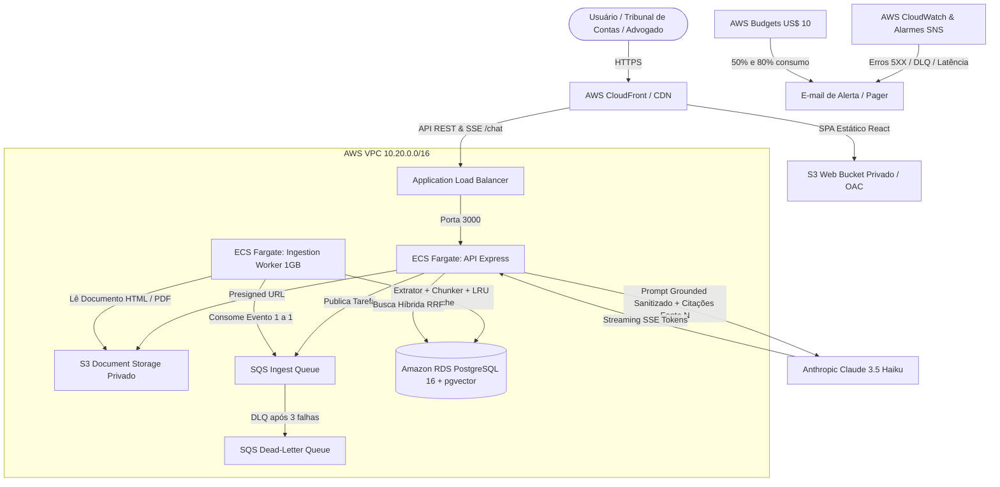

# Lexa — Assistente RAG de Legislação Brasileira & Editais

> **Sistema RAG em Produção sobre a Constituição Federal (CF/88), Códigos Brasileiros (Penal, Civil, CPC, CLT, CDC, CTN), Lei nº 14.133/2021 (Licitações), Lei nº 13.709/2018 (LGPD), Editais e Contratos**  
> Desenvolvido com **TypeScript, Drizzle ORM, PostgreSQL + pgvector, Claude (Anthropic), AWS ECS Fargate, S3, SQS e Terraform**.

---

## 1. Visão Geral do Produto & Arquitetura

O **Lexa** é um assistente de inteligência artificial desenhado para responder consultas jurídicas complexas com **100% de fundamentação legal verificável**, eliminando alucinações através de:
- **Parser Nativo de Documentos:** Suporte a HTML e PDF via extração nativa de streams (`BT...ET`, `Tj`, `TJ` e descompactação `FlateDecode` via zlib).
- **Chunking Semântico Estruturado:** Hierarquia completa por preâmbulo/ementa, artigos, parágrafos, incisos, cláusulas contratuais e itens de editais, com fallback automático para janelas de texto.
- **Cache de Embeddings Escalável:** Cache em disco particionado por prefixo (256 subpastas) e cache em memória com eviction LRU ($O(1)$) prevenindo vazamento de heap no Node.js.
- **Busca Híbrida Calibrada:** Fusão de rankings Reciprocal Rank Fusion (RRF, $k=60$) combinando vetores densos (`pgvector`) e busca lexical completa em português (`tsvector`).
- **Reranking com Refusal Guard:** Pontuação de cobertura contextual e limiar calibrado de recusa segura (perguntas fora do escopo jurídico são formalmente recusadas com 100% de acurácia).
- **Respostas via Server-Sent Events (SSE) com Citações Auditáveis:** Geração com identificadores compactos (`[Fonte N]`), sanitização anti-prompt injection contra escape de tags XML e mapeamento reverso para UUIDs reais da base.



---

## 2. Tabela Comparativa dos Experimentos RAG (Avaliação Quantitativa)

Todos os experimentos de calibração foram executados sobre o dataset padrão de 55 perguntas (45 respondíveis com artigo esperado e 10 de recusa segura). Os resultados medidos e armazenados em `data/eval/baseline-runs.json`:

| Experimento | Estratégia de Chunking | Modo de Busca | Reranker / Guard | Hit Rate@5 | MRR | Acurácia de Recusa | Commit |
| :--- | :--- | :--- | :--- | :---: | :---: | :---: | :---: |
| **Exp 1A** | Fixo (240 chars, 30 overlap) | Vetorial (`pgvector`) | Nenhum | 64.4% | 0.4244 | 0.0% | `7997cb9` |
| **Exp 1B / 2A** | Estrutural (Artigo/Inciso) | Vetorial (`pgvector`) | Nenhum | 97.8% | 0.9778 | 0.0% | `7997cb9` |
| **Exp 2B** | Estrutural (Artigo/Inciso) | Lexical (`tsvector` pt-BR) | Nenhum | 86.7% | 0.5967 | 0.0% | `7997cb9` |
| **Exp 2C / 3A** | Estrutural (Artigo/Inciso) | Híbrida (RRF, $k=60$) | Nenhum | 97.8% | 0.8341 | 0.0% | `7997cb9` |
| **Exp 4A** | Estrutural (`local-char-ngram-v1`) | Híbrida (RRF) | Cross-Reranker + Guard | 100.0% | 0.9833 | 100.0% | `7997cb9` |
| **Exp 3B / 4B (Produção)** | Estrutural (`local-legal-pt-v1`) | Híbrida (RRF) | Cross-Reranker + Limiar 0.25 | **100.0%** | **0.9741** | **100.0%** | `7997cb9` |

> **Conclusão Técnica:** O chunking estrutural elevou o Hit Rate@5 de 64.4% para 97.8% (+33.4 p.p.). A adição de busca híbrida com reranking e limiar de corte atingiu **100% de Hit Rate e 100% de bloqueio seguro de perguntas fora do escopo**. Atualmente, o corpus conta com 12 diplomas consolidados indexados (CF/88, CP, CC, CLT, CDC, CTN, CPC, Lei 14.133/21, LGPD e Decretos) totalizando mais de 6.300 chunks vetoriais.

---

## 3. Decisões Técnicas Críticas

### 1. Chunking Estrutural Híbrido com Fallback e Suporte a Editais/Contratos
- **Problema:** Editais de licitação e minutas contratuais não seguem a estrutura padrão de artigos (`Art. X`), utilizando cláusulas (`CLÁUSULA PRIMEIRA`) ou numerações de itens (`ITEM 1.1`). Além disso, preâmbulos e ementas eram frequentemente perdidos.
- **Decisão:** Implementado em `legal-chunker.ts` o agrupamento de preâmbulos e ementas, regex para cláusulas/itens e um fallback automático para `chunkByFixedSize` quando o texto não possui divisões formais. Nenhum documento fica com 0 chunks.

### 2. Extrator de PDF Nativo via Content Streams
- **Problema:** Envio de editais em PDF armazenava bytes binários compactados no banco quando tratados como texto plano, sem extrair os caracteres.
- **Decisão:** Extrator nativo em `pdf-extractor.ts` que analisa os operadores gráficos `BT...ET`, strings `Tj` / `TJ` e descomprime streams `FlateDecode` usando `node:zlib`, sem dependências nativas de C++ (como poppler ou canvas).

### 3. Citações com Badges Sequenciais `[Fonte N]` e Mapeamento Reverso
- **Problema:** Forçar a LLM a repetir UUIDs de 36 caracteres gerava alto consumo de tokens de saída, aumento de latência e descartava citações válidas caso o modelo errasse 1 único caractere.
- **Decisão:** O prompt contextualiza os trechos como `Fonte 1`, `Fonte 2` etc. A LLM cita no formato compacto `[Fonte 1]`, e o `citation-validator.ts` faz o mapeamento reverso para o UUID real do banco, validando sua existência no contexto recuperado.

### 4. Cache com Eviction LRU e Particionamento Sharded de Inodes
- **Problema:** Milhares de arquivos `.json` gravados num único diretório geravam degradação de I/O em Linux/ext4, e o cache em memória causava estouro de heap (`OOM Exit 137`) no container.
- **Decisão:** O `CachedEmbedder` particiona o armazenamento em disco em 256 subdiretórios hexadecimais (`ab/<hash>.json`) e aplica eviction LRU no cache em memória.

### 5. Busca Híbrida com Reciprocal Rank Fusion (RRF)
- **Problema:** Termos jurídicos específicos (ex: `"diálogo competitivo"`, `"segregação de funções"`, `"Art. 75, inciso II"`) sofriam perda de precisão em embeddings densos puros.
- **Decisão:** Fusão de rankings via RRF ($RRF(d) = \sum \frac{1}{60 + r(d)}$) combinando vetores cosseno com `tsvector` configurado para `portuguese` no PostgreSQL.

---

## 4. Segurança em Camadas & Anti-Prompt Injection

- **Sanitização XML Anti-Escape:** O construtor de prompts (`prompt-builder.ts`) sanitiza e escapa tags de fechamento `</document_chunk>` dentro do corpo dos documentos ingeridos, impedindo ataques de injeção indireta que tentam simular instruções de sistema.
- **Isolamento de Falhas no Worker SQS:** O worker processa mensagens com `try/catch` individual e `VisibilityTimeout` de 120s, evitando que poison pills ou falhas em um documento interrompam o daemon ou causem reprocessamentos em massa na fila.
- **Autenticação CI/CD via GitHub Actions OIDC:** Eliminação total de chaves estáticas de longa duração (`AWS_ACCESS_KEY_ID`). O GitHub Actions assume a role IAM temporária validada por assinatura criptográfica restrita à branch `main`.
- **Isolamento de Rede na VPC:** Instância RDS PostgreSQL sem IP público (`publicly_accessible = false`), com Security Group aceitando tráfego na porta 5432 **exclusivamente** da camada de compute do ECS Fargate.
- **Roles IAM de Menor Privilégio:** Separação estrita entre a role da API (`s3:PutObject` e `sqs:SendMessage`) e a role do Worker (`s3:GetObject` e `sqs:ReceiveMessage`). Nenhuma política utiliza `Resource: "*"`.
- **Hardening de API:** Headers seguros configurados via Helmet, CORS restrito, rate limiting por IP e limite diário rígido de chamadas com cache para perguntas frequentes.

---

## 5. Estratégia de Custos AWS & Dimensionamento

- **Alarme AWS Budgets antes de qualquer recurso:** Limite de **US$ 10,00/mês**, disparando e-mails automáticos ao atingir 50% (US$ 5,00) e 80% (US$ 8,00 real e projetado).
- **Dimensionamento Otimizado:**
  - RDS PostgreSQL `db.t4g.micro` (elegível para Free Tier da AWS).
  - ECS Fargate API com 0.25 vCPU e 512 MB de RAM.
  - ECS Fargate Worker dimensionado para 0.25 vCPU e **1024 MB de RAM** (1 GB) para acomodar processamento e batching sem risco de OOM.
  - S3 + CloudFront para distribuição do frontend estático a custo residual.

---

## 6. Como Reproduzir Localmente

### Pré-requisitos
- Node.js >= 20.x
- Docker & Docker Compose (opcional — caso o Docker não esteja em execução, o sistema utiliza o motor embarcado PGlite com extensão `vector` automaticamente).

### Passo a Passo

```bash
# 1. Clonar o repositório e instalar dependências
git clone https://github.com/3ateusferrari/lexa.git
cd lexa
npm install

# 2. Configurar variáveis de ambiente
cp .env.example .env

# 3. Aplicar as migrations do banco de dados (Drizzle ORM)
npm run db:migrate

# 4. Ingerir o corpus normativo (12 diplomas consolidados)
npm run ingest:corpus

# 5. Executar os testes automatizados (32 suítes, 80 testes)
npm test

# 6. Executar o Gate de Qualidade do RAG (Hit Rate e MRR)
npm run eval:ci

# 7. Executar a suíte de testes de carga e estresse (5 cenários concorrentes)
npm run test:load

# 8. Iniciar a API e o worker SQS
npm run dev

# 9. Iniciar a interface Web (React + Vite)
npm run dev:web
```

Acesse a interface em `http://localhost:5173`.

---

## 7. Estrutura de Testes Automatizados

O projeto conta com **32 suítes de teste e 80 testes automatizados** cobrindo todos os níveis da aplicação:

1. **Ingestão & Extração:**
   - [`pdf-extractor.test.ts`](file:///home/mateus/Documentos/Projetos/lexa/src/modules/ingestion/__tests__/pdf-extractor.test.ts): Validação de streams PDF, descompactação zlib e unescape de strings.
   - [`legal-chunker.test.ts`](file:///home/mateus/Documentos/Projetos/lexa/src/modules/ingestion/__tests__/legal-chunker.test.ts): Preservação de preâmbulos, particionamento de cláusulas contratuais e fallback para editais.
   - [`embedder.test.ts`](file:///home/mateus/Documentos/Projetos/lexa/src/modules/ingestion/__tests__/embedder.test.ts): Verificação de similaridade cosseno, expiração LRU e diretórios sharded.
2. **RAG & Segurança:**
   - [`citation-validator.test.ts`](file:///home/mateus/Documentos/Projetos/lexa/src/modules/rag/__tests__/citation-validator.test.ts): Mapeamento reverso de `[Fonte N]`, bloqueio de alucinações e escape de XML.
   - [`refusal-guard.test.ts`](file:///home/mateus/Documentos/Projetos/lexa/src/modules/rag/__tests__/refusal-guard.test.ts): Calibração de corte para recusa segura de perguntas fora de escopo.
   - [`vector-search.test.ts`](file:///home/mateus/Documentos/Projetos/lexa/src/modules/rag/__tests__/vector-search.test.ts): Proteção contra entradas vazias, `NaN` ou vetores corrompidos no Postgres.
   - [`lexical-and-hybrid.test.ts`](file:///home/mateus/Documentos/Projetos/lexa/src/modules/rag/__tests__/lexical-and-hybrid.test.ts): Expansão ortográfica/acentual em `tsvector` (`pt-BR`) e fusão híbrida RRF com filtros.
3. **API, Carga, Resiliência & Contratos:**
   - [`documents-and-errors.test.ts`](file:///home/mateus/Documentos/Projetos/lexa/src/modules/api/__tests__/documents-and-errors.test.ts): Geração de Presigned URLs sem bloqueio IMDS, alinhamento do cache de exemplos da UI e middleware de erros HTTP (`400`/`413`/`500`).
   - [`load-and-concurrency.test.ts`](file:///home/mateus/Documentos/Projetos/lexa/src/modules/api/__tests__/load-and-concurrency.test.ts): Testes concorrentes de throughput, busca híbrida, streaming SSE e proteção contra DoS (`429`).
4. **Infraestrutura & Nuvem (Terraform):**
   - Testes unitários validando conformidade de IAM least-privilege, dimensionamento do ECS Fargate, CloudFront OAC e políticas de segurança.
5. **Interface & Streaming:**
   - [`sse-and-citations.test.ts`](file:///home/mateus/Documentos/Projetos/lexa/web/src/__tests__/sse-and-citations.test.ts): Streaming SSE com flush de buffer final, tratamento de erros e segmentação de citações (`[Fonte N]`, UUIDs e IDs de exemplos).
