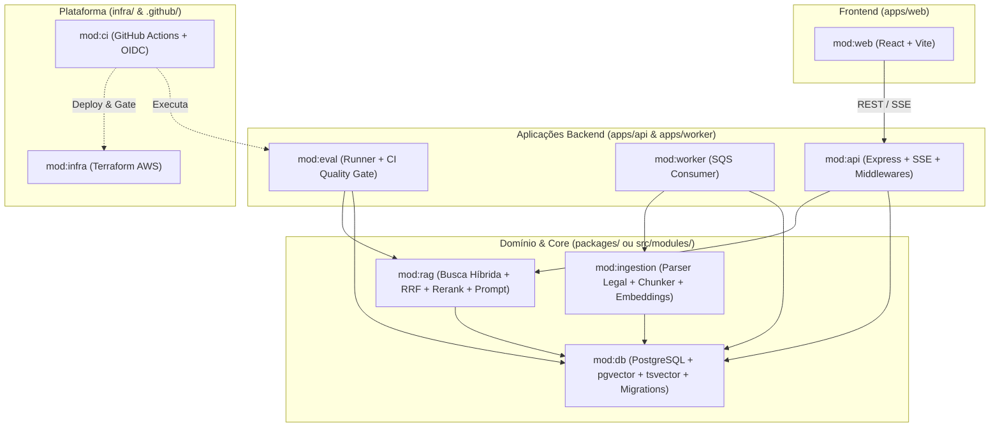

# Plano Modular, Milestones e Issues — Assistente RAG de Legislação e Editais (Lexa)

> **Baseado na especificação:** [plano-rag-legislacao.md](file:///home/mateus/Documentos/Projetos/lexa/plano-rag-legislacao.md)
> **Para execução com agentes:** Utilize a skill `superpowers:subagent-driven-development` ou `superpowers:executing-plans` para implementar issue por issue seguindo os ciclos de TDD e os marcadores `[à mão]` / `[IA ok]`.

**Objetivo:** Construir e publicar em 10 semanas um assistente de busca semântica e híbrida (RAG) sobre legislação e editais brasileiros (Lei 14.133/2021 e LGPD), com citações verificáveis por artigo, avaliação automatizada com gate no CI/CD (OIDC) e infraestrutura em Terraform na AWS.

---

## 1. Decomposição em Módulos Menores

Para evitar acoplamento entre ingestão, motor de busca RAG, avaliação, camada HTTP e infraestrutura, o projeto é dividido em **9 módulos com responsabilidades únicas e interfaces claras**:

### Mapa de Módulos e Responsabilidades

| Módulo | Caminho Sugerido | Responsabilidade Única | Consome | Produz (Interface Pública) |
| :--- | :--- | :--- | :--- | :--- |
| **`mod:db`** | `src/modules/db/` | Conexão PostgreSQL (`pg` + **Drizzle ORM**), migrations via **Drizzle Kit**, schemas e repositórios tipados para as 5 tabelas (`documents`, `chunks`, `ingestion_jobs`, `eval_questions`, `eval_runs`). | Variáveis de ambiente (`DATABASE_URL`) | `DocumentsRepo`, `ChunksRepo`, `IngestionJobsRepo`, `EvalRepo`, migrations Drizzle |
| **`mod:ingestion`** | `src/modules/ingestion/` | Limpeza de PDF/HTML, parser da hierarquia legal brasileira (`Título > Capítulo > Artigo > Parágrafo/Inciso`), cálculo de `content_hash` (SHA-256) e geração de **embeddings locais** em lote com cache por hash. | `mod:db`, Modelo de Embeddings Local (`Transformers.js` / `Ollama`, ex.: `multilingual-e5` / `bge-m3`) | `extractLegalText()`, `chunkByLegalStructure()`, `embedChunksWithCache()`, `ingestDocument()` |
| **`mod:rag`** | `src/modules/rag/` | Busca vetorial (`pgvector`), busca textual (`tsvector`), fusão **RRF**, **Reranking**, limiar de recusa (abstenção), montagem de prompt blindado contra *prompt injection* para **Claude (Anthropic)** e validador de citações (`[chunk_id]`). | `mod:db`, Anthropic SDK (`@anthropic-ai/sdk`) & Reranker | `vectorSearch()`, `hybridSearchRRF()`, `rerankChunks()`, `generateCitedAnswerStream()`, `validateCitations()` |
| **`mod:eval`** | `src/modules/eval/` | Dataset ouro (`eval_questions`), cálculo de **Hit Rate@k**, **MRR**, **Taxa de Recusa Correta** e **Citação Válida**, persistência em `eval_runs` e comparador de regressão para falhar o CI. | `mod:rag`, `mod:db` | `runEvaluationSuite()`, `compareWithBaseline()`, CLI `npm run eval:ci` |
| **`mod:api`** | `src/modules/api/` | Servidor Express, validação Zod, rotas (`POST /search`, `POST /chat` via SSE, `POST /documents/upload-url`, `GET /eval/runs`, `GET /health`), rate limiting, limite diário de LLM, Helmet/CORS e logs JSON com `request_id`. | `mod:rag`, `mod:db`, AWS S3/SQS SDK | App Express (`createApp()`), servidor HTTP |
| **`mod:worker`** | `src/modules/worker/` | Polling da fila SQS, download do documento no S3, invocação do `mod:ingestion`, atualização de `ingestion_jobs` (`queued` → `processing` → `done`/`failed`) e suporte a retry/DLQ. | `mod:ingestion`, `mod:db`, AWS SQS/S3 SDK | Processo worker (`startWorker()`) |
| **`mod:web`** | `web/` | SPA React + Vite + TypeScript: chat com streaming SSE, citações clicáveis que abrem o artigo original destacado, 3 perguntas de exemplo, upload de documentos e aba de Painel de Qualidade (`eval_runs`). | `mod:api` (via HTTP/SSE) | Build estático para S3 + CloudFront |
| **`mod:infra`** | `infra/terraform/` | Submódulos Terraform: `budget`, `network`, `database` (RDS), `storage` (S3 + CloudFront), `queue` (SQS + DLQ), `compute` (ECR + ECS Fargate/App Runner), `iam` (roles separadas + OIDC) e `observability` (CloudWatch). | Conta AWS | Recursos provisionados na AWS e outputs para CI/CD |
| **`mod:ci`** | `.github/workflows/` | Workflows `ci.yml` (PR: lint, typecheck, testes Testcontainers, build, gate de avaliação RAG, `terraform plan`) e `deploy.yml` (push `main`: OIDC, ECR, migrations, ECS, S3/CloudFront). | `mod:eval`, `mod:infra` | Automação de qualidade e deploy contínuo |

---

## 2. Visão Geral dos Milestones (10 Semanas)

| Milestone | Fase do Plano | Semanas | Módulos Principais | Gate de Saída (Critério de Aceite) |
| :--- | :--- | :---: | :--- | :--- |
| **M1: Fundação & Busca Vetorial Local** | Fase 1 · Busca local | 1–2 | `mod:db`, `mod:ingestion`, `mod:rag`, `mod:api`, `mod:ci` | Ambiente sobe com `docker compose up`; pergunta via terminal (`POST /search`) retorna o artigo correto da Lei 14.133; testes com Testcontainers passando no CI. |
| **M2: Avaliação & Busca Híbrida com Reranking** | Fase 2 · Avaliação e busca híbrida | 3–4 | `mod:eval`, `mod:rag` | Dataset de 50+ perguntas (incluindo ~10 sem resposta) avaliado; busca híbrida (pgvector + tsvector + RRF + reranking) superando baseline vetorial; tabela de experimentos no README. |
| **M3: Chat Streaming, Ingestão Assíncrona & Frontend** | Fase 3 · Chat e front | 5–6 | `mod:api`, `mod:worker`, `mod:web` | Demo local completa: chat via SSE com citação clicável, recusa quando abaixo do limiar, validador de citações, fila SQS (LocalStack) processando PDFs e painel de qualidade React. |
| **M4: Infraestrutura AWS com Terraform** | Fase 4 · AWS | 7–8 | `mod:infra` | Alarme de custo ativo; infra provisionada via Terraform (RDS, ECR, ECS/App Runner, SQS+DLQ, S3, CloudFront, IAM mínimo privilégio, Secrets Manager); URL pública respondendo E2E. |
| **M5: CI/CD com OIDC & Gate de Qualidade** | Fase 5 · CI/CD | 9 | `mod:ci`, `mod:eval`, `mod:infra` | Deploy automatizado na `main` via OIDC (sem chaves fixas); PR que degrada Hit Rate@5 ou MRR falha automaticamente a pipeline (`ci.yml`). |
| **M6: Observabilidade, Hardening & Publicação** | Fase 6 · Acabamento | 10 | `mod:api`, `mod:infra`, `mod:web`, Docs | Logs JSON com `request_id`, métricas e alarmes CloudWatch ativos, limite diário de LLM testado, README definitivo, vídeo demo gravado e checklist de publicação 100% cumprido. |

---

## 3. Detalhamento de Milestones e Issues

> [!IMPORTANT]
> As tags **`[à mão]`** indicam tarefas cujo núcleo deve ser escrito por você (com a IA atuando apenas como revisora/explicadora) para garantir domínio completo nas perguntas de entrevista. As tags **`[IA ok]`** indicam tarefas de scaffolding, configuração repetitiva ou UI que podem ser delegadas e revisadas por você.

---

### Milestone 1: Fundação & Busca Vetorial Local (Semanas 1–2)

**Objetivo:** Ter a ingestão estrutural da Lei 14.133/2021 e da LGPD e a busca vetorial (`POST /search`) funcionando localmente em Docker Compose e testadas com Testcontainers.

#### `ISSUE-01` · Setup do Monorepo/Projeto TypeScript, Docker Compose e `.env.example`
- **Módulo:** `mod:db` / Configuração Base
- **Execução:** `[IA ok]`
- **Dependências:** Nenhuma
- **Descrição:** Configurar estrutura inicial do projeto Node.js + TypeScript (`strict: true`), ESLint, Prettier, Vitest e `docker-compose.yml` contendo PostgreSQL 16 com extensão `pgvector/pgvector:pg16`.
- **Arquivos:**
  - Criar: `package.json`, `tsconfig.json`, `.eslintrc.cjs`, `.prettierrc`, `.env.example`, `docker-compose.yml`
- **Tarefas:**
  - [ ] Configurar scripts `build`, `dev`, `lint`, `typecheck` (`tsc --noEmit`) e `test` no `package.json`.
  - [ ] Configurar serviço `postgres` com imagem `pgvector/pgvector:pg16` e healthcheck no `docker-compose.yml`.
  - [ ] Documentar variáveis necessárias em `.env.example` (`DATABASE_URL`, `LOCAL_EMBEDDING_MODEL`, `ANTHROPIC_API_KEY`, `ANTHROPIC_MODEL`, `PORT`).
- **Critério de Aceite:** `docker compose up -d` sobe o banco saudável; `npm run lint` e `npm run typecheck` executam sem erros.

#### `ISSUE-02` · Pipeline de CI Inicial (Lint, Typecheck e Testes)
- **Módulo:** `mod:ci`
- **Execução:** `[IA ok]`
- **Dependências:** `ISSUE-01`
- **Descrição:** Criar workflow inicial no GitHub Actions para validar qualidade de código e testes a cada Pull Request.
- **Arquivos:**
  - Criar: `.github/workflows/ci.yml`
- **Tarefas:**
  - [ ] Configurar job disparado em `pull_request` e `push` na `main` com Node LTS e cache de dependências.
  - [ ] Executar `npm run lint`, `npm run typecheck` e `npm test`.
- **Critério de Aceite:** Abrir um PR executa o workflow `.github/workflows/ci.yml` com sucesso.

#### `ISSUE-03` · Schema Drizzle ORM, Extensão `pgvector` e Migrations (`drizzle-kit`)
- **Módulo:** `mod:db`
- **Execução:** `[à mão]`
- **Dependências:** `ISSUE-01`
- **Descrição:** Configurar **Drizzle ORM** (`drizzle-orm`, `drizzle-kit`, `pg`) e implementar o schema e as migrations versionadas criando a extensão `vector` e as 5 tabelas do modelo de dados (`documents`, `chunks`, `ingestion_jobs`, `eval_questions`, `eval_runs`), incluindo índices HNSW e GIN (`tsvector` em português).
- **Arquivos:**
  - Criar: `drizzle.config.ts`, `src/modules/db/schema.ts`, `src/modules/db/migrations/`, `src/modules/db/client.ts`, `src/modules/db/repositories/`
- **Tarefas:**
  - [ ] Definir tabela `documents` no Drizzle com `content_hash text NOT NULL UNIQUE`.
  - [ ] Definir tabela `chunks` com coluna vetorial `vector(D)` (dimensão conforme modelo local, ex.: 384d para `multilingual-e5-small` ou 1024d para `bge-m3`) e coluna gerada `tsv tsvector GENERATED ALWAYS AS (to_tsvector('portuguese', content)) STORED`.
  - [ ] Criar índices `chunks_embedding_idx` (`USING hnsw (embedding vector_cosine_ops)`) e `chunks_tsv_idx` (`USING gin (tsv)`) na migration SQL gerada pelo Drizzle Kit.
  - [ ] Definir tabelas `ingestion_jobs`, `eval_questions` e `eval_runs` no `schema.ts`.
  - [ ] Criar repositórios usando Drizzle ORM e `sql` template tag para inserção e consulta de `documents` e `chunks`.
- **Critério de Aceite:** Comandos `npm run db:generate` e `npm run db:migrate` aplicam o schema do zero em um banco vazio sem erros.

#### `ISSUE-04` · Download Oficial do Corpus Inicial e Extrator de Texto Limpo
- **Módulo:** `mod:ingestion`
- **Execução:** `[à mão]`
- **Dependências:** `ISSUE-01`
- **Descrição:** Baixar a Lei 14.133/2021 (Licitações e Contratos) e a Lei 13.709/2018 (LGPD) de fontes oficiais (`planalto.gov.br`), registrar metadados e data de download, e implementar o extrator/higienizador de HTML/PDF para texto limpo.
- **Arquivos:**
  - Criar: `data/corpus/manifest.json`, `src/modules/ingestion/extractor.ts`, `src/modules/ingestion/__tests__/extractor.test.ts`
- **Tarefas:**
  - [ ] Salvar os arquivos fonte em `data/corpus/` e registrar URL oficial, data de download e tipo (`lei`) em `data/corpus/manifest.json`.
  - [ ] Implementar `extractCleanText(input, format)` removendo cabeçalhos repetidos, rodapés, números de página isolados e trechos revogados/vetados conforme regra definida.
  - [ ] Escrever testes unitários garantindo limpeza de ruído sem perda de artigos.
- **Critério de Aceite:** Testes unitários de extração passam e retornam texto contínuo e higienizado da Lei 14.133 e da LGPD.

#### `ISSUE-05` · Chunker Estrutural de Legislação Brasileira
- **Módulo:** `mod:ingestion`
- **Execução:** `[à mão]`
- **Dependências:** `ISSUE-04`
- **Descrição:** Dividir o texto limpo respeitando a estrutura normativa brasileira (um chunk por Artigo; subdivisão por Parágrafo `§` ou Inciso romano `I, II, III...` quando o artigo exceder o limite de tokens), mantendo `section_path` (`Título > Capítulo > Seção`) e `article` (`Art. 75`) como metadado e prefixo do conteúdo embutido.
- **Arquivos:**
  - Criar: `src/modules/ingestion/legal-chunker.ts`, `src/modules/ingestion/__tests__/legal-chunker.test.ts`
  - Criar (para experimento comparativo da Fase 2): `src/modules/ingestion/fixed-chunker.ts`
- **Tarefas:**
  - [ ] Implementar máquina de estados / regex para rastrear hierarquia (`TÍTULO`, `CAPÍTULO`, `SEÇÃO`, `Art. Nº`).
  - [ ] Gerar objetos `LegalChunk` contendo `{ position, article, sectionPath, page, content, embeddedText }`.
  - [ ] Implementar também um chunker de tamanho fixo (`fixed-chunker.ts`) para servir de baseline no experimento da Fase 2.
  - [ ] Testar casos de borda: `Art. 1º` a `Art. 9º` (ordinal) vs `Art. 10` (cardinal), `Parágrafo único`, artigos longos como o `Art. 6º` e `Art. 75` da Lei 14.133.
- **Critério de Aceite:** `chunkByLegalStructure` extrai corretamente o `Art. 75` da Lei 14.133 com seu `section_path` completo (`Título II > Capítulo VIII > Seção I`).

#### `ISSUE-06` · Gerador de Embeddings Locais em Lote com Cache por Hash e Script de Ingestão CLI
- **Módulo:** `mod:ingestion`
- **Execução:** `[à mão]`
- **Dependências:** `ISSUE-03`, `ISSUE-05`
- **Descrição:** Implementar provedor de **embeddings local** (ex.: via `@huggingface/transformers` / `Transformers.js` ou `Ollama` com modelo multilíngue como `intfloat/multilingual-e5-small` ou `BAAI/bge-m3`) em lote com cache baseado no SHA-256 do texto do chunk e idempotência por `content_hash` do documento.
- **Arquivos:**
  - Criar: `src/modules/ingestion/embedder.ts`, `src/modules/ingestion/ingest-service.ts`, `src/scripts/ingest-corpus.ts`
- **Tarefas:**
  - [ ] Implementar cálculo de `content_hash` do documento para pular re-ingestão caso inalterado.
  - [ ] Implementar geração de embeddings local em lotes (batches) e cache por hash do texto do chunk (em `.cache/embeddings` ou consulta em `chunks` existentes).
  - [ ] Permitir parametrizar o modelo local via variável de ambiente (`LOCAL_EMBEDDING_MODEL`) para viabilizar o Experimento 4 (comparação de dois modelos de embeddings locais).
  - [ ] Criar comando `npm run ingest:corpus` para ingerir o `manifest.json`.
- **Critério de Aceite:** Rodar `npm run ingest:corpus` duas vezes seguidas popula o banco na 1ª execução e reutiliza 100% do cache na 2ª execução.

#### `ISSUE-07` · Endpoint `POST /search` com Busca Vetorial e Validação Zod
- **Módulo:** `mod:rag`, `mod:api`
- **Execução:** `[à mão]`
- **Dependências:** `ISSUE-06`
- **Descrição:** Criar a busca vetorial por similaridade de cosseno (`<=>` no `pgvector`) e expor o endpoint `POST /search` validado com Zod.
- **Arquivos:**
  - Criar: `src/modules/rag/vector-search.ts`, `src/modules/api/routes/search.route.ts`, `src/modules/api/app.ts`, `src/modules/api/server.ts`
- **Tarefas:**
  - [ ] Implementar `vectorSearch(queryEmbedding, topK, filters)` retornando `{ chunkId, documentId, title, article, sectionPath, content, score }`.
  - [ ] Validar payload `{ query: z.string().min(3).max(500), k: z.number().int().min(1).max(20).default(5) }` com Zod.
  - [ ] Expor `POST /search` e `GET /health`.
- **Critério de Aceite:** Consulta via `curl -X POST http://localhost:3000/search -d '{"query":"dispensa de licitação por valor"}'` retorna o `Art. 75` da Lei 14.133/2021 entre os primeiros resultados.

#### `ISSUE-08` · Testes de Integração de Ingestão e Busca com Testcontainers
- **Módulo:** `mod:db`, `mod:rag`, `mod:api`
- **Execução:** `[IA ok]`
- **Dependências:** `ISSUE-07`
- **Descrição:** Configurar suíte de testes de integração levantando um container real `pgvector/pgvector:pg16` via `@testcontainers/postgresql`, rodando migrations, inserindo chunks com embeddings determinísticos (mock do provedor externo) e testando `POST /search` com Supertest.
- **Arquivos:**
  - Criar: `tests/integration/setup-testcontainer.ts`, `tests/integration/search.integration.test.ts`
- **Tarefas:**
  - [ ] Subir container Postgres com `pgvector` antes da suíte e aplicar migrations.
  - [ ] Testar deduplicação por `content_hash`, busca vetorial ordenada por distância de cosseno e erro 400 do Zod para payloads inválidos.
- **Critério de Aceite:** `npm run test:integration` passa localmente e no GitHub Actions (`ci.yml`).

---

### Milestone 2: Avaliação & Busca Híbrida com Reranking (Semanas 3–4)

**Objetivo:** Construir o diferencial técnico do projeto antes do frontend: um dataset manual de avaliação, métricas objetivas (`Hit Rate@k`, `MRR`, `Taxa de Recusa`), busca híbrida com RRF, reranking e a tabela de experimentos comparativos.

#### `ISSUE-09` · Dataset Manual de Avaliação (50 a 100 Perguntas + Perguntas Sem Resposta)
- **Módulo:** `mod:eval`
- **Execução:** `[à mão]`
- **Dependências:** `ISSUE-06`
- **Descrição:** Elaborar manualmente de 50 a 100 perguntas reais sobre a Lei 14.133/2021 e a LGPD, mapeando o `expected_article` (ex.: `"Art. 75"`) e o documento correspondente, além de ~10 perguntas fora do escopo (`expected_article: null`) para medir recusa correta.
- **Arquivos:**
  - Criar: `data/eval/questions.json`, `src/scripts/seed-eval-questions.ts`
- **Tarefas:**
  - [ ] Escrever 40–80 perguntas respondíveis com variedade léxica e semântica (paráfrases jurídicas e termos exatos de incisos/prazos).
  - [ ] Escrever ~10 perguntas sem resposta no corpus (ex.: regras da CLT, Código Penal, alíquotas de IRPF) com `expected_article: null`.
  - [ ] Criar script `npm run eval:seed` para sincronizar `data/eval/questions.json` na tabela `eval_questions`.
- **Critério de Aceite:** Tabela `eval_questions` populada com ≥ 50 perguntas (sendo ≥ 10 com `expected_article IS NULL`).

#### `ISSUE-10` · Motor de Avaliação (`Hit Rate@k`, `MRR`, `Taxa de Recusa`) e Baseline Vetorial
- **Módulo:** `mod:eval`
- **Execução:** `[à mão]`
- **Dependências:** `ISSUE-07`, `ISSUE-09`
- **Descrição:** Implementar o cálculo de métricas de recuperação e persistência na tabela `eval_runs` (registrando `git_sha` e `config` JSONB), e executar a medição de baseline (apenas busca vetorial).
- **Arquivos:**
  - Criar: `src/modules/eval/metrics.ts`, `src/modules/eval/eval-runner.ts`, `src/ modules/eval/__tests__/metrics.test.ts`, `src/scripts/run-eval.ts`
- **Tarefas:**
  - [ ] Implementar funções puras `calculateHitRateAtK(results, expectedArticle, k)`, `calculateMRR(results, expectedArticle)` e `calculateRefusalAccuracy()`.
  - [ ] Gravar execução em `eval_runs` com `git_sha`, `config` (`{ chunking, searchMode, k, embeddingModel, reranker }`), `hit_rate` e `mrr`.
  - [ ] Rodar e registrar o baseline vetorial puro (`searchMode: "vector"`).
- **Critério de Aceite:** `npm run eval:run` executa todo o dataset, exibe tabela no terminal e grava linha em `eval_runs`.

#### `ISSUE-11` · Busca Lexical Full-Text (`tsvector`) e Fusão por Reciprocal Rank Fusion (RRF)
- **Módulo:** `mod:rag`
- **Execução:** `[à mão]`
- **Dependências:** `ISSUE-10`
- **Descrição:** Implementar a busca textual no PostgreSQL (`plainto_tsquery('portuguese', $1)` / `websearch_to_tsquery` com `ts_rank_cd`) em paralelo com a busca vetorial (top 20 cada) e fundir os rankings via **Reciprocal Rank Fusion (RRF)** ($k_{rrf} = 60$).
- **Arquivos:**
  - Criar: `src/modules/rag/lexical-search.ts`, `src/modules/rag/rrf.ts`, `src/modules/rag/hybrid-search.ts`, `src/modules/rag/__tests__/rrf.test.ts`
- **Tarefas:**
  - [ ] Implementar query SQL utilizando o índice GIN em `chunks.tsv` com ranking textual em português.
  - [ ] Implementar `fuseRankingsRRF(vectorResults, lexicalResults, k = 60)` ordenando pela soma $\sum \frac{1}{k + \text{rank}_i}$.
  - [ ] Executar ` Vector` e `Lexical` em paralelo (`Promise.all`) em `hybridSearch()`.
  - [ ] Escrever testes unitários provando que o RRF independe da escala bruta dos scores vetorial vs textual.
- **Critério de Aceite:** Testes de RRF passam e nova execução do `npm run eval:run -- --mode=hybrid` registra métricas em `eval_runs`.

#### `ISSUE-12` · Reranking de Candidatos e Calibração do Limiar de Recusa
- **Módulo:** `mod:rag`, `mod:eval`
- **Execução:** `[à mão]`
- **Dependências:** `ISSUE-11`
- **Descrição:** Adicionar etapa de Reranking sobre os melhores candidatos da fusão RRF (reduzindo de ~20 para os top 5 trechos) e calibrar com base no dataset de avaliação o limiar de relevância abaixo do qual o sistema recusa responder sem chamar o LLM.
- **Arquivos:**
  - Criar: `src/modules/rag/reranker.ts`, `src/modules/rag/refusal-guard.ts`, `src/modules/rag/__tests__/refusal-guard.test.ts`
- **Tarefas:**
  - [ ] Implementar interface `Reranker` e adaptador (Cohere Rerank API / Bedrock Rerank / Cross-encoder ou LLM listwise reranker).
  - [ ] Implementar `shouldRefuse(topChunks, minThreshold)` que retorna `{ refused: true, reason }` quando o melhor score fica abaixo do limiar calibrado.
  - [ ] Medir a **Taxa de Recusa Correta** nas ~10 perguntas sem resposta do dataset e ajustar o limiar.
- **Critério de Aceite:** Perguntas fora do corpus atingem alta taxa de recusa sem degradar o Hit Rate@5 das perguntas válidas.

#### `ISSUE-13` · Execução da Bateria de Experimentos e Documentação da Tabela Comparativa
- **Módulo:** `mod:eval`, Documentação
- **Execução:** `[à mão]`
- **Dependências:** `ISSUE-05`, `ISSUE-10`, `ISSUE-11`, `ISSUE-12`
- **Descrição:** Rodar os 4 experimentos obrigatórios exigidos pelo plano e documentar as tabelas de resultados reais e a justificativa do RRF no `README.md`.
- **Arquivos:**
  - Modificar: `README.md`
  - Criar: `docs/experiments-log.md`
- **Tarefas:**
  - [ ] Experimento 1: Chunking por estrutura legal vs. Chunking de tamanho fixo.
  - [ ] Experimento 2: Busca só vetorial vs. só texto (`tsvector`) vs. híbrida (RRF).
  - [ ] Experimento 3: Busca híbrida sem reranking vs. com reranking.
  - [ ] Experimento 4: Comparação entre dois modelos/configurações de embeddings.
  - [ ] Documentar no `README.md` a resposta para *"Por que RRF em vez de somar scores?"* e a tabela comparativa com `Hit Rate@5`, `MRR` e `Taxa de Recusa`.
- **Critério de Aceite:** Todas as execuções estão salvas em `eval_runs` e a tabela de experimentos está documentada no `README.md`.

---

### Milestone 3: Chat Streaming, Ingestão Assíncrona & Frontend (Semanas 5–6)

**Objetivo:** Entregar a experiência completa localmente: endpoint de chat com streaming SSE, blindagem contra prompt injection, validação de citações, upload assíncrono via S3 + SQS (LocalStack) + Worker e interface React com citações clicáveis e painel de qualidade.

#### `ISSUE-14` · Endpoint `POST /chat` com Streaming SSE (Claude / Anthropic), Anti-Prompt Injection e Validação de Citações
- **Módulo:** `mod:rag`, `mod:api`
- **Execução:** `[à mão]`
- **Dependências:** `ISSUE-12`
- **Descrição:** Implementar a geração de resposta via **Anthropic Claude API (`@anthropic-ai/sdk`)** fundamentada nos top 5 chunks recuperados, transmitida via Server-Sent Events (SSE), com separação estrita entre instruções de sistema (`system` parameter do Claude) e dados de documentos e validação pós-resposta de que os identificadores citados (`[chunk_id]`) pertencem ao conjunto recuperado.
- **Arquivos:**
  - Criar: `src/modules/rag/prompt-builder.ts`, `src/modules/rag/citation-validator.ts`, `src/modules/rag/chat-service.ts`, `src/modules/api/routes/chat.route.ts`
  - Criar: `src/modules/rag/__tests__/citation-validator.test.ts`
- **Tarefas:**
  - [ ] Construir prompt usando o parâmetro `system` nativo da Anthropic e delimitando os trechos recuperados como dados não-confiáveis (`<document_chunk id="...">...</document_chunk>`), instruindo o Claude a ignorar comandos contidos dentro dos documentos.
  - [ ] Se `shouldRefuse` retornar `true`, retornar evento SSE de recusa imediata (`"Não encontrei base nos documentos indexados para responder a esta pergunta."`) sem chamar a API da Anthropic.
  - [ ] Transmitir eventos SSE (`event: token`, `event: citations`, `event: done`) usando `anthropic.messages.stream()`.
  - [ ] Implementar `validateCitations(responseText, retrievedChunkIds)` verificando se toda citação `[id]` existe nos trechos recuperados.
- **Critério de Aceite:** `POST /chat` transmite tokens do Claude em tempo real, devolve os metadados dos artigos citados e bloqueia citações alucinadas.

#### `ISSUE-15` · Upload via URL Assinada S3, Fila SQS (LocalStack) e Worker de Ingestão
- **Módulo:** `mod:worker`, `mod:api`, `mod:ingestion`
- **Execução:** `[à mão]`
- **Dependências:** `ISSUE-06`
- **Descrição:** Desacoplar a ingestão de documentos da API HTTP usando LocalStack (S3 + SQS + DLQ) no `docker-compose.yml` e criar o processo Worker que consome a fila, processa o documento e atualiza `ingestion_jobs`.
- **Arquivos:**
  - Modificar: `docker-compose.yml`
  - Criar: `scripts/localstack-init.sh`, `src/modules/api/routes/documents.route.ts`, `src/modules/worker/sqs-worker.ts`, `src/modules/worker/__tests__/sqs-worker.test.ts`
- **Tarefas:**
  - [ ] Adicionar serviço `localstack` ao `docker-compose.yml` criando bucket S3 `lexa-documents`, fila `lexa-ingestion-queue` e `lexa-ingestion-dlq` (`maxReceiveCount: 3`).
  - [ ] Criar rota `POST /documents/upload-url` (validando extensão `.pdf`/`.html` e tamanho máximo) que gera Presigned URL do S3 e registra `ingestion_jobs` com `status = 'queued'`, mais `GET /documents/jobs/:id`.
  - [ ] Implementar worker que consome mensagens SQS, atualiza status para `processing`, incrementa `attempts`, executa `ingestDocument()` e marca `done` ou `failed` (gravando `error`).
- **Critério de Aceite:** Upload de um PDF via URL assinada dispara mensagem na fila SQS, o worker ingere os artigos no Postgres e o status do job muda para `done`; arquivo corrompido vai para a DLQ após 3 tentativas.

#### `ISSUE-16` · Hardening da API: Rate Limiting, Limite Diário de Orçamento LLM, Helmet, CORS e Erros
- **Módulo:** `mod:api`
- **Execução:** `[à mão]`
- **Dependências:** `ISSUE-14`
- **Descrição:** Proteger a API pública contra abuso de chamadas ao LLM e padronizar respostas de erro.
- **Arquivos:**
  - Criar: `src/modules/api/middlewares/rate-limit.ts`, `src/modules/api/middlewares/daily-budget.ts`, `src/modules/api/middlewares/error-handler.ts`, `src/modules/rag/example-cache.ts`
- **Tarefas:**
  - [ ] Configurar `helmet`, `cors` restrito à origem do frontend e limite de payload JSON (`express.json({ limit: '32kb' })`).
  - [ ] Implementar rate limiting por IP na rota `POST /chat`.
  - [ ] Implementar contador diário de chamadas ao LLM no servidor (`MAX_DAILY_LLM_CALLS`), retornando HTTP 429 com mensagem amigável quando atingir o teto do dia.
  - [ ] Implementar cache de respostas para as 3 perguntas de exemplo da tela inicial para custo zero em visitas rápidas de recrutadores.
- **Critério de Aceite:** Exceder o rate limit por IP ou o limite diário global retorna HTTP 429 padronizado; perguntas de exemplo não consomem cota do LLM.

#### `ISSUE-17` · Frontend React: Interface de Chat com Streaming SSE e Citações Clicáveis
- **Módulo:** `mod:web`
- **Execução:** `[IA ok]`
- **Dependências:** `ISSUE-14`, `ISSUE-16`
- **Descrição:** Criar aplicação React + Vite + TypeScript com interface de consulta jurídica, 3 perguntas de exemplo clicáveis na tela inicial, streaming de resposta e painel lateral de inspeção do artigo citado.
- **Arquivos:**
  - Criar: `web/package.json`, `web/vite.config.ts`, `web/src/App.tsx`, `web/src/components/ChatPanel.tsx`, `web/src/components/CitationDrawer.tsx`, `web/src/components/ExampleQuestions.tsx`
- **Tarefas:**
  - [ ] Implementar tela inicial sem login com aviso claro de projeto de portfólio (*"Não substitui consulta jurídica"*), 3 perguntas de exemplo clicáveis e seletor de documentos ativos (Lei 14.133 / LGPD).
  - [ ] Consumir stream SSE de `POST /chat` renderizando tokens progressivamente e badges clicáveis para cada citação (ex.: `[Art. 75 - Lei 14.133]`).
  - [ ] Ao clicar na citação, abrir painel lateral exibindo o `section_path`, número do artigo e texto integral do chunk recuperado com destaque visual.
- **Critério de Aceite:** Fluxo de 30 segundos do recrutador (abrir página → clicar em pergunta de exemplo → ler resposta → clicar na citação e ver o artigo original) funciona sem fricção.

#### `ISSUE-18` · Frontend React: Painel de Qualidade (`eval_runs`) e Tela de Upload
- **Módulo:** `mod:web`, `mod:api`
- **Execução:** `[IA ok]`
- **Dependências:** `ISSUE-10`, `ISSUE-15`, `ISSUE-17`
- **Descrição:** Expor endpoint `GET /eval/runs` na API e construir no frontend a aba visível do **Painel de Qualidade** (mostrando Hit Rate@k, MRR, configuração de chunking/reranker e histórico de commits) e o modal de upload de novos documentos.
- **Arquivos:**
  - Criar: `src/modules/api/routes/eval.route.ts`, `web/src/components/QualityDashboard.tsx`, `web/src/components/DocumentUploadModal.tsx`
- **Tarefas:**
  - [ ] Criar `GET /eval/runs` retornando as últimas execuções de `eval_runs` e resumo do dataset.
  - [ ] Construir componente `QualityDashboard` exibindo cards de `Hit Rate@5`, `MRR`, `Taxa de Recusa` e tabela comparativa dos experimentos registrados.
  - [ ] Construir componente de upload que solicita Presigned URL, envia para o S3 e acompanha o status do job até `done`.
- **Critério de Aceite:** Aba "Qualidade do RAG" renderiza dados reais vindos da tabela `eval_runs`.

---

### Milestone 4: Infraestrutura AWS com Terraform (Semanas 7–8)

**Objetivo:** Provisionar toda a infraestrutura na AWS como código usando Terraform, seguindo o princípio de menor privilégio e controle rigoroso de custos, colocando a aplicação no ar em uma URL pública.

#### `ISSUE-19` · Alarme de Orçamento AWS (`aws_budgets_budget`) e Backend Remoto do Terraform
- **Módulo:** `mod:infra`
- **Execução:** `[à mão]`
- **Dependências:** Nenhuma (Pré-requisito obrigatório antes de qualquer recurso AWS)
- **Descrição:** Configurar o backend de state do Terraform (S3 + lock) e criar o alarme de orçamento mensal na AWS antes de provisionar banco ou computação.
- **Arquivos:**
  - Criar: `infra/terraform/versions.tf`, `infra/terraform/variables.tf`, `infra/terraform/modules/budget/main.tf`
- **Tarefas:**
  - [ ] Configurar `aws_budgets_budget` com limite mensal baixo (ex.: USD 10–15) e alerta por e-mail em 50%, 80% e 100% do valor real e previsto.
  - [ ] Aplicar o módulo `budget` isoladamente e confirmar recebimento/ativação na conta AWS.
- **Critério de Aceite:** Alarme de orçamento ativo no console AWS Billing antes da criação de VPC/RDS/ECS.

#### `ISSUE-20` · Terraform: Rede (VPC), Banco de Dados (RDS PostgreSQL) e Storage (S3 + SQS + DLQ)
- **Módulo:** `mod:infra`
- **Execução:** `[à mão a estrutura; IA ok para sintaxe]`
- **Dependências:** `ISSUE-19`
- **Descrição:** Provisionar rede, **Amazon RDS PostgreSQL** com suporte a `pgvector`, bucket S3 de documentos com notificação de eventos e fila SQS com Dead-Letter Queue (DLQ).
- **Arquivos:**
  - Criar: `infra/terraform/modules/network/`, `infra/terraform/modules/database/`, `infra/terraform/modules/storage_queue/`
- **Tarefas:**
  - [ ] Criar VPC, subnets públicas/privadas e Security Groups permitindo tráfego na porta 5432 apenas a partir das tasks ECS Fargate da API e do Worker.
  - [ ] Provisionar **RDS PostgreSQL** (`db.t4g.micro`) com armazenamento mínimo e backups básicos.
  - [ ] Criar bucket S3 de documentos (privado, CORS para upload assinado) e fila SQS de ingestão + fila DLQ com `maxReceiveCount = 3`.
- **Critério de Aceite:** `terraform validate` e `terraform plan` executam sem erros; RDS acessível apenas internamente pelas tasks ECS.

#### `ISSUE-21` · Terraform: Segredos (Secrets Manager / SSM) e Roles IAM de Menor Privilégio
- **Módulo:** `mod:infra`
- **Execução:** `[à mão]`
- **Dependências:** `ISSUE-20`
- **Descrição:** Criar políticas e roles IAM estritamente separadas para a **API** e para o **Worker**, além de armazenar credenciais (`DATABASE_URL`, `ANTHROPIC_API_KEY`) no AWS Secrets Manager / SSM Parameter Store.
- **Arquivos:**
  - Criar: `infra/terraform/modules/security/main.tf`, `infra/terraform/modules/security/outputs.tf`
- **Tarefas:**
  - [ ] Role da **API**: permissão apenas para gerar `s3:PutObject` no bucket de documentos e ler seus próprios segredos (`DATABASE_URL`, `ANTHROPIC_API_KEY`). Sem permissão de consumir SQS ou deletar objetos.
  - [ ] Role do **Worker**: permissão apenas para `sqs:ReceiveMessage`/`DeleteMessage` na fila de ingestão, `s3:GetObject` no bucket de documentos e leitura dos segredos.
  - [ ] Configurar segredos no SSM / Secrets Manager (nunca em variáveis de texto plano no Git).
- **Critério de Aceite:** Inspeção das policies IAM comprova separação entre API e Worker sem uso de `Action: "*"` ou `Resource: "*"` indevidos.

#### `ISSUE-22` · Terraform: ECR, Computação (ECS Fargate) e Frontend (S3 + CloudFront)
- **Módulo:** `mod:infra`
- **Execução:** `[à mão a estrutura; IA ok para sintaxe]`
- **Dependências:** `ISSUE-20`, `ISSUE-21`
- **Descrição:** Criar repositórios ECR, `Dockerfile` multi-stage para API/Worker (com modelo de embedding local pré-baixado na imagem para evitar cold start), cluster e serviços **AWS ECS Fargate** com healthcheck `/health` e distribuição CloudFront com Origin Access Control (OAC) para o bucket S3 do React.
- **Arquivos:**
  - Criar: `Dockerfile`, `infra/terraform/modules/compute/`, `infra/terraform/modules/cdn/`, `infra/terraform/main.tf`, `infra/terraform/outputs.tf`
- **Tarefas:**
  - [ ] Escrever `Dockerfile` multi-stage enxuto (`node:20-slim`/`alpine`, usuário não-root, cache do modelo de embedding local embutido no build) servindo API e Worker.
  - [ ] Configurar repositórios ECR com política de lifecycle (manter últimas 10 imagens).
  - [ ] Configurar Cluster e Services da API e do Worker no **ECS Fargate** injetando segredos do SSM/Secrets Manager.
  - [ ] Configurar bucket S3 privado do frontend + CloudFront HTTPS entregando a SPA React.
- **Critério de Aceite:** `terraform apply` sobe toda a infraestrutura e exibe as URLs da API e do CloudFront nos outputs.

#### `ISSUE-23` · Migrations no Deploy, Ingestão do Corpus em Produção e Teste E2E Público
- **Módulo:** `mod:db`, `mod:ingestion`, `mod:infra`
- **Execução:** `[à mão]` (migrations/ingestão) e `[IA ok]` (teste E2E)
- **Dependências:** `ISSUE-22`
- **Descrição:** Rodar as migrations e a ingestão da Lei 14.133/2021 e da LGPD no banco da AWS, popular os dados de avaliação e validar o funcionamento ponta a ponta pela URL pública do CloudFront.
- **Arquivos:**
  - Criar: `scripts/deploy-migrate-and-seed.sh`, `tests/e2e/public-url.smoke.test.ts`
- **Tarefas:**
  - [ ] Executar migrations contra o RDS via task/job seguro na AWS.
  - [ ] Ingerir o corpus inicial (Lei 14.133 e LGPD) e sincronizar a tabela `eval_runs` com os experimentos.
  - [ ] Executar smoke test E2E verificando `GET /health`, `POST /search`, streaming SSE no `POST /chat` e abertura do frontend no CloudFront.
- **Critério de Aceite:** URL pública do CloudFront abre sem cadastro, responde com streaming e citações clicáveis e exibe o Painel de Qualidade.

---

### Milestone 5: CI/CD com OIDC & Gate de Qualidade (Semana 9)

**Objetivo:** Automatizar completamente os testes, o gate de qualidade do RAG e o deploy contínuo na AWS usando autenticação OIDC sem nenhuma chave estática (`AWS_ACCESS_KEY_ID`) salva no GitHub.

#### `ISSUE-24` · Provedor de Identidade OIDC do GitHub Actions e Role IAM de Deploy
- **Módulo:** `mod:infra`, `mod:ci`
- **Execução:** `[à mão]`
- **Dependências:** `ISSUE-21`
- **Descrição:** Configurar no Terraform o provedor OIDC `token.actions.githubusercontent.com` e a role IAM exclusiva de deploy restrita ao repositório `3ateusferrari/lexa`.
- **Arquivos:**
  - Criar: `infra/terraform/modules/oidc_github/main.tf`
- **Tarefas:**
  - [ ] Declarar `aws_iam_openid_connect_provider` para o GitHub Actions.
  - [ ] Criar role IAM `lexa-github-deploy-role` com condição `StringEquals` / `StringLike` no campo `sub` (`repo:3ateusferrari/lexa:ref:refs/heads/main`) e `aud: sts.amazonaws.com`.
  - [ ] Conceder apenas permissões necessárias para push no ECR, update de serviço ECS, sync no S3 do frontend e `cloudfront:CreateInvalidation`.
- **Critério de Aceite:** Nenhum segredo `AWS_ACCESS_KEY_ID` ou `AWS_SECRET_ACCESS_KEY` existe nas configurações do repositório GitHub.

#### `ISSUE-25` · Gate de Qualidade do RAG no Workflow de PR (`ci.yml`) + Comentário de `terraform plan`
- **Módulo:** `mod:ci`, `mod:eval`
- **Execução:** `[à mão]` (gate de avaliação) e `[IA ok]` (`terraform plan` no PR)
- **Dependências:** `ISSUE-02`, `ISSUE-12`, `ISSUE-24`
- **Descrição:** Evoluir o workflow `.github/workflows/ci.yml` para rodar build da imagem Docker, executar a suíte de avaliação do RAG comparando `Hit Rate@5` e `MRR` contra a baseline da `main` (falhando o build se cair além da tolerância), varredura de segredos e comentário automático do `terraform plan` no PR.
- **Arquivos:**
  - Criar: `src/scripts/eval-gate.ts`
  - Modificar: `.github/workflows/ci.yml`
- **Tarefas:**
  - [ ] Implementar `src/scripts/eval-gate.ts` que compara o `Hit Rate@5` e `MRR` do PR com a última execução da `main` (ou baseline versionada) e encerra com `process.exit(1)` se houver regressão acima da tolerância definida.
  - [ ] Adicionar step de scan de segredos (ex.: Gitleaks / TruffleHog) e fixar versões das GitHub Actions + configurar `.github/dependabot.yml`.
  - [ ] Adicionar step que roda `terraform fmt -check`, `terraform validate` e publica o resumo do `terraform plan` como comentário no PR.
- **Critério de Aceite:** Workflow `ci.yml` valida código, imagem Docker, Terraform e qualidade do RAG a cada PR.

#### `ISSUE-26` · Workflow de Deploy Contínuo (`deploy.yml`) na Branch `main`
- **Módulo:** `mod:ci`
- **Execução:** `[à mão]`
- **Dependências:** `ISSUE-23`, `ISSUE-24`
- **Descrição:** Criar `.github/workflows/deploy.yml` disparado em push na `main` que autentica via OIDC, faz push da imagem marcada com o `git_sha` para o ECR, roda migrations, atualiza o serviço da API/Worker, faz build/sync do React para o S3 e invalida o cache do CloudFront.
- **Arquivos:**
  - Criar: `.github/workflows/deploy.yml`, `docs/runbook-rollback.md`
- **Tarefas:**
  - [ ] Configurar `permissions: id-token: write, contents: read` e `aws-actions/configure-aws-credentials` usando a role OIDC.
  - [ ] Taguear imagem Docker com `${{ github.sha }}` e fazer push para o ECR.
  - [ ] Executar migrations antes de atualizar a task definition do ECS.
  - [ ] Fazer `aws s3 sync web/dist s3://$FRONTEND_BUCKET --delete` e `aws cloudfront create-invalidation --paths "/*"`.
  - [ ] Documentar procedimento de rollback por SHA em `docs/runbook-rollback.md`.
- **Critério de Aceite:** Merge na `main` implanta automaticamente nova versão do backend e frontend rastreável pelo commit SHA.

#### `ISSUE-27` · Prova Real do Quality Gate (PR de Teste Degradando o Chunking)
- **Módulo:** `mod:ci`, `mod:eval`
- **Execução:** `[à mão]`
- **Dependências:** `ISSUE-25`
- **Descrição:** Abrir um Pull Request propositalmente degradando a estratégia de chunking/busca para comprovar que o gate de avaliação falha a pipeline do GitHub Actions, mantendo o link do PR fechado como evidência para o README e entrevistas.
- **Arquivos:**
  - Nenhum arquivo permanente na `main` (PR de demonstração fechado após falha comprovada)
- **Tarefas:**
  - [ ] Criar branch `test/degrade-chunking-gate-proof`, alterar o chunker ou top-k para degradar o `Hit Rate@5` e abrir PR.
  - [ ] Verificar falha do step `RAG Quality Gate` no GitHub Actions com log claro da queda de métrica.
  - [ ] Fechar o PR sem mergear e salvar o link/captura para o `README.md`.
- **Critério de Aceite:** PR registrado no histórico do GitHub com check vermelho do Quality Gate.

---

### Milestone 6: Observabilidade, Hardening & Publicação (Semana 10)

**Objetivo:** Adicionar logs estruturados com correlação ponta a ponta, métricas e alarmes no CloudWatch, finalizar documentação de alto impacto para recrutadores, gravar demo e atualizar currículo.

#### `ISSUE-28` · Logs Estruturados JSON com `request_id` Atravessando API, SQS e Worker
- **Módulo:** `mod:api`, `mod:worker`
- **Execução:** `[à mão a escolha; IA ok para configuração]`
- **Dependências:** `ISSUE-14`, `ISSUE-15`
- **Descrição:** Implementar logger estruturado em JSON (ex.: `pino`) gerando `request_id` em cada requisição HTTP, propagando-o nos atributos da mensagem SQS e nos logs do Worker, além de registrar métricas por consulta (latência da busca, latência da geração, tokens consumidos e status de recusa).
- **Arquivos:**
  - Criar: `src/modules/shared/logger.ts`, `src/modules/api/middlewares/request-context.ts`
  - Modificar: `src/modules/api/routes/chat.route.ts`, `src/modules/worker/sqs-worker.ts`
- **Tarefas:**
  - [ ] Gerar/propagar `x-request-id` em todas as respostas HTTP e logs JSON.
  - [ ] Logar evento estruturado `rag_query_completed` com `{ requestId, searchLatencyMs, llmLatencyMs, promptTokens, completionTokens, refused, citedArticlesCount }`.
  - [ ] Propagar `requestId` nos `MessageAttributes` do SQS para rastrear ingestão da API até o Worker.
- **Critério de Aceite:** Consultar os logs permite filtrar um único `requestId` e ver todas as etapas (API → Busca/LLM ou API → Fila → Worker).

#### `ISSUE-29` · Alarmes no CloudWatch (Erros 5xx, Mensagens na DLQ e Latência)
- **Módulo:** `mod:infra`
- **Execução:** `[à mão a escolha; IA ok para configuração]`
- **Dependências:** `ISSUE-22`, `ISSUE-28`
- **Descrição:** Configurar no Terraform os Log Groups com retenção curta (ex.: 14 dias para controle de custo), Metric Filters e CloudWatch Alarms para erros 5xx na API e para `ApproximateNumberOfMessagesVisible > 0` na fila DLQ de ingestão.
- **Arquivos:**
  - Criar: `infra/terraform/modules/observability/main.tf`
- **Tarefas:**
  - [ ] Definir retenção de 14 dias nos grupos de log do CloudWatch.
  - [ ] Criar alarme `api-5xx-errors-alarm` e `ingestion-dlq-not-empty-alarm` conectados a tópico SNS (e-mail).
- **Critério de Aceite:** `terraform apply` cria os alarmes no CloudWatch com estado `OK`.

#### `ISSUE-30` · README Definitivo (Diagrama, Decisões, Experimentos, Custos e Uso de IA)
- **Módulo:** Documentação
- **Execução:** `[à mão]`
- **Dependências:** `ISSUE-13`, `ISSUE-23`, `ISSUE-27`, `ISSUE-29`
- **Descrição:** Escrever o `README.md` exatamente na ordem de leitura de um recrutador/tech lead, respondendo todas as perguntas técnicas previstas no plano.
- **Arquivos:**
  - Modificar: `README.md`
- **Tarefas:**
  - [ ] Seção 1: Frase resumo do projeto, link da demo pública e GIF/screenshot da citação clicável e do painel de qualidade.
  - [ ] Seção 2: Diagrama de arquitetura (Fluxo de Consulta Síncrona e Fluxo de Ingestão Assíncrona).
  - [ ] Seção 3: Como rodar localmente com um comando (`docker compose up`).
  - [ ] Seção 4: Decisões e trade-offs (PostgreSQL + `pgvector`, chunking por artigo vs fixo, busca híbrida + por que RRF, OIDC vs access keys, SQS + DLQ).
  - [ ] Seção 5: Resultados da avaliação e tabela dos 4 experimentos + link para o PR que falhou no gate.
  - [ ] Seção 6: Segurança, estimativa de custo mensal e procedimento de teardown (`terraform destroy`).
  - [ ] Seção 7: Declaração transparente de uso de IA (onde a IA apoiou e confirmação de que arquitetura, avaliação e decisões são suas).
- **Critério de Aceite:** Qualquer desenvolvedor consegue clonar o repositório e subir o ambiente local seguindo apenas o `README.md`.

#### `ISSUE-31` · Gravação do Vídeo Demo (1–2 min) e Simulação do Roteiro de Entrevista
- **Módulo:** Apresentação & Portfólio
- **Execução:** `[à mão]`
- **Dependências:** `ISSUE-23`, `ISSUE-30`
- **Descrição:** Gravar vídeo curto demonstrando o fluxo completo na URL pública e praticar as 7 perguntas do roteiro de entrevista + explicação de arquivo aleatório.
- **Arquivos:**
  - Criar: `docs/interview-prep-notes.md` (notas próprias de resposta rápida)
- **Tarefas:**
  - [ ] Gravar vídeo de 1 a 2 minutos mostrando: pergunta jurídica → streaming com citação → clique no artigo → pergunta fora do corpus sendo recusada → aba do Painel de Qualidade → PR barrado pelo CI.
  - [ ] Responder em voz alta, sem abrir o código, todas as 7 perguntas do roteiro de entrevista do [plano-rag-legislacao.md](file:///home/mateus/Documentos/Projetos/lexa/plano-rag-legislacao.md#L325-L333).
- **Critério de Aceite:** Vídeo publicado e linkado no topo do `README.md`.

#### `ISSUE-32` · Checklist Final de Publicação, Currículo (com Métricas Reais) e Plano de Teardown
- **Módulo:** Portfólio & Operação
- **Execução:** `[à mão]`
- **Dependências:** `ISSUE-30`, `ISSUE-31`
- **Descrição:** Validar todos os 11 itens do checklist de publicação do [plano-rag-legislacao.md](file:///home/mateus/Documentos/Projetos/lexa/plano-rag-legislacao.md#L335-L349), preencher os colchetes `[N]`, `[X]%` e `[Y]` do bullet do currículo com os números reais de `eval_runs` e testar o script de `terraform destroy` / recriação.
- **Arquivos:**
  - Criar: `scripts/teardown-aws.sh`
- **Tarefas:**
  - [ ] Preencher bullet do currículo com os números medidos em `eval_runs`.
  - [ ] Auditar histórico Git (`git log -p`) garantindo zero vazamento de segredos.
  - [ ] Fixar repositório no perfil do GitHub e atualizar portfólio/LinkedIn.
- **Critério de Aceite:** Todos os 11 itens do Checklist de Publicação marcados como concluídos.

---

## 4. Grafo de Dependências entre Issues

```mermaid
flowchart LR
    subgraph "M1: Busca Local (Sem 1-2)"
        I01["ISSUE-01: Setup & Compose"] --> I02["ISSUE-02: CI Inicial"]
        I01 --> I03["ISSUE-03: Schema & Migrations"]
        I01 --> I04["ISSUE-04: Corpus & Extrator"]
        I04 --> I05["ISSUE-05: Chunker Legal"]
        I03 --> I06["ISSUE-06: Embeddings & Ingest CLI"]
        I05 --> I06
        I06 --> I07["ISSUE-07: POST /search"]
        I07 --> I08["ISSUE-08: Testcontainers"]
    end

    subgraph "M2: Eval & Híbrido (Sem 3-4)"
        I06 --> I09["ISSUE-09: Dataset 50+ Perguntas"]
        I07 --> I10["ISSUE-10: Eval Runner & Baseline"]
        I09 --> I10
        I10 --> I11["ISSUE-11: tsvector + RRF"]
        I11 --> I12["ISSUE-12: Rerank & Recusa"]
        I12 --> I13["ISSUE-13: 4 Experimentos"]
    end

    subgraph "M3: Chat, Fila & Front (Sem 5-6)"
        I12 --> I14["ISSUE-14: POST /chat SSE & Citações"]
        I06 --> I15["ISSUE-15: S3 + SQS Worker"]
        I14 --> I16["ISSUE-16: Rate Limit & Daily Budget"]
        I16 --> I17["ISSUE-17: Front Chat + Citações"]
        I15 --> I18["ISSUE-18: Front Painel Qualidade"]
        I17 --> I18
    end

    subgraph "M4: AWS Terraform (Sem 7-8)"
        I19["ISSUE-19: AWS Budget Alarm"] --> I20["ISSUE-20: VPC, RDS, S3, SQS"]
        I20 --> I21["ISSUE-21: IAM & Secrets"]
        I21 --> I22["ISSUE-22: ECR, ECS, CloudFront"]
        I18 --> I23["ISSUE-23: Deploy & E2E Público"]
        I22 --> I23
    end

    subgraph "M5: CI/CD OIDC (Sem 9)"
        I21 --> I24["ISSUE-24: OIDC AWS"]
        I12 --> I25["ISSUE-25: CI Gate RAG + TF Plan"]
        I24 --> I25
        I23 --> I26["ISSUE-26: Deploy Workflow"]
        I24 --> I26
        I25 --> I27["ISSUE-27: Prova de Falha no PR"]
    end

    subgraph "M6: Acabamento (Sem 10)"
        I15 --> I28["ISSUE-28: Logs JSON & request_id"]
        I28 --> I29["ISSUE-29: CloudWatch Alarms"]
        I27 --> I30["ISSUE-30: README Final"]
        I29 --> I30
        I30 --> I31["ISSUE-31: Vídeo & Entrevista"]
        I31 --> I32["ISSUE-32: Publicação & Currículo"]
    end
```

---

## 5. Decisões Arquiteturais Definidas

As 4 decisões que estavam em aberto no [plano-rag-legislacao.md](file:///home/mateus/Documentos/Projetos/lexa/plano-rag-legislacao.md#L35-L42) foram definidas:

1. **Geração de Embeddings:** **Modelo Local** (via `@huggingface/transformers` / `Transformers.js` ou `Ollama`, ex.: `intfloat/multilingual-e5-small` vs `BAAI/bge-m3` para o Experimento 4, custo zero de API de embeddings).
2. **Provedor de LLM:** **Anthropic Claude** (`@anthropic-ai/sdk`).
3. **Acesso a Dados e Migrations:** **Drizzle ORM** (`drizzle-orm` + `drizzle-kit` + `pg`), utilizando `sql` raw template tags nas queries de busca híbrida (`pgvector` + `tsvector`) e RRF.
4. **Banco e Computação na AWS (Padrão de Mercado):** **Amazon RDS PostgreSQL** + **AWS ECS Fargate**.
