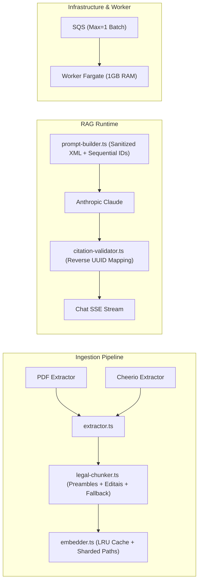

# Lexa Future Improvements & Reverse Engineering Implementation Plan

> **For agentic workers:** REQUIRED SUB-SKILL: Use superpowers:subagent-driven-development to implement this plan task-by-task. Steps use checkbox (`- [ ]`) syntax for tracking.

**Goal:** Implement key architectural and resilience improvements identified in the reverse-engineering audit across ingestion (PDF parsing, structural chunking for editais/contracts, LRU cache), RAG citations & prompt-injection sanitization, SQS worker scaling, and AWS infrastructure sizing.

**Architecture:** 
1. Create a native PDF stream extractor in `src/modules/ingestion/pdf-extractor.ts` and integrate it into `extractor.ts`.
2. Enhance `legal-chunker.ts` to capture preambles/ementas, parse clauses/items of editais and contracts, and fallback cleanly to fixed chunking if no legal articles exist.
3. Add memory LRU eviction and prefix-partitioned disk storage in `CachedEmbedder` to prevent heap OOMs and inode exhaustion.
4. Convert Claude citations from cumbersome 36-char UUIDs to compact sequential labels (`[Fonte 1]`, `[Fonte 2]`) with reverse mapping in `citation-validator.ts`, and sanitize XML tag closing in `prompt-builder.ts`.
5. Adjust SQS worker loop concurrency (`MaxNumberOfMessages: 1`) to eliminate message visibility timeout races on large legal texts.
6. Update Terraform ECS task definition memory from 512MB to 1024MB for worker tasks and document RDS scaling guidelines.

**Architecture Diagram:**

**Tech Stack:** TypeScript, Node.js 20+, zlib, Drizzle ORM, PostgreSQL (pgvector), AWS SDK v3, Terraform.

## Global Constraints
- Must maintain 100% test compatibility across existing 28 test suites.
- No heavy native C++ binaries (e.g. canvas/poppler); use zero-external-dependency stream extraction for PDF.
- Preserve backward-compatibility for UUID citations while supporting sequential `[Fonte N]` badges.
- All code changes must pass `npm run typecheck`, `npm run lint`, `npm test`, and `npm run build:web`.

---

### Task 1: Native PDF Stream Text Extractor

**Files:**
- Create: `src/modules/ingestion/pdf-extractor.ts`
- Modify: `src/modules/ingestion/extractor.ts`
- Test: `src/modules/ingestion/__tests__/pdf-extractor.test.ts`

- [ ] **Step 1: Write tests for PDF stream text extractor**
- [ ] **Step 2: Implement `src/modules/ingestion/pdf-extractor.ts`**
- [ ] **Step 3: Integrate with `src/modules/ingestion/extractor.ts`**
- [ ] **Step 4: Verify tests pass**

### Task 2: Structural Chunker with Preambles, Clauses & Edital Fallback

**Files:**
- Modify: `src/modules/ingestion/legal-chunker.ts`
- Test: `src/modules/ingestion/__tests__/legal-chunker.test.ts`

- [ ] **Step 1: Write unit tests for preambles, contracts/editais, and fixed-size fallback**
- [ ] **Step 2: Implement preamble extraction, clause/item patterns, and fallback logic**
- [ ] **Step 3: Verify all chunker tests pass**

### Task 3: Ingestion Cache Memory LRU & Path Sharding

**Files:**
- Modify: `src/modules/ingestion/embedder.ts`
- Test: `src/modules/ingestion/__tests__/embedder.test.ts`

- [ ] **Step 1: Write tests for LRU eviction and sharded disk cache path**
- [ ] **Step 2: Implement LRU map and sharded directory paths**
- [ ] **Step 3: Verify embedder tests pass**

### Task 4: Compact Citations Mapping & Prompt Injection Sanitization

**Files:**
- Modify: `src/modules/rag/prompt-builder.ts`
- Modify: `src/modules/rag/citation-validator.ts`
- Test: `src/modules/rag/__tests__/citation-validator.test.ts`

- [ ] **Step 1: Write tests for sequential citation reverse-mapping and XML sanitization**
- [ ] **Step 2: Implement sequential source tags and XML boundary escaping in prompt-builder**
- [ ] **Step 3: Implement reverse mapping from `[Fonte N]` and `[N]` back to chunk UUID in citation-validator**
- [ ] **Step 4: Verify citation validator tests pass**

### Task 5: SQS Worker Batch Optimization & Visibility Protection

**Files:**
- Modify: `src/modules/worker/sqs-worker.ts`
- Modify: `src/modules/api/routes/documents.route.ts`
- Test: `src/modules/worker/__tests__/sqs-worker.test.ts`

- [ ] **Step 1: Update SQS worker ReceiveMessageCommand to use MaxNumberOfMessages: 1**
- [ ] **Step 2: Verify SQS worker tests pass**

### Task 6: Cloud Infrastructure Sizing

**Files:**
- Modify: `infra/terraform/modules/compute/main.tf`
- Test: `tests/infra/dockerfile-and-compute-cdn.test.ts`

- [ ] **Step 1: Update Worker Fargate task definition memory from 512 to 1024**
- [ ] **Step 2: Update infrastructure unit tests to verify new Fargate sizing**
- [ ] **Step 3: Run terraform fmt and terraform validate**

### Task 7: Full Verification Suite

- [ ] **Step 1: Run `npm run typecheck`**
- [ ] **Step 2: Run `npm run lint`**
- [ ] **Step 3: Run `npm test`**
- [ ] **Step 4: Run `npm run eval:ci`**
- [ ] **Step 5: Run `npm run build:web`**
